# Выполненные работы
1. [Практическая работа № 1. Знакомство с Go](#практическая-работа--1-знакомство-с-go)
2. [Практическая работа № 2. Условия, циклы, функции и коллекции](#практическая-работа--2-условия-циклы-функции-и-коллекции)
3. [Практическая работа № 3. Структуры, методы и указатели](#практическая-работа--3-структуры-методы-и-указатели)
4. [Практическая работа № 4. Интерфейсы, ошибки и консольное приложение](#практическая-работа--4-интерфейсы-ошибки-и-консольное-приложение)


# Практическая работа № 1. Знакомство с Go

Курс «Бэкенд-разработка на языке Go».

## Окружение

- Операционная система: macOS Tahoe 26.7.1.
- Версия Go: go1.27.2 darwin/arm64.
- Редактор: Visual Studio Code.

## Выполнено
Проверено: проект запускается локально.
1. Первая программа
2. Карточка студента курса
3. Перевод минут в часы
4. Дополнительное задание. Среднее время решения

## Запуск первой программы

Откройте терминал в папке проекта, где находятся `main.go` и `go.mod`.

```text
go run .
```

## Проверка сборки и оформления

```text
go fmt ./...
go build ./...
```

## Дополнительные программы
2. go run ./cmd/card
3. go run ./cmd/time-converter
4. go run ./cmd/average

## Проверенные данные
1. Была изменена строка вывода, сам вывод поменялся на новую строку
2. Изменил name на "Дональд', число выполненных работ на 500. Значения в выводе изменились
3. 
1) Введите количество минут: 0
Начальное число минут: 0. Итоговое число часов: 0, число минут: 0.
2) Введите количество минут: 59
Начальное число минут: 59. Итоговое число часов: 0, число минут: 59.
3) Введите количество минут: 60
Начальное число минут: 60. Итоговое число часов: 1, число минут: 0.
4) Введите количество минут: 125
Начальное число минут: 125. Итоговое число часов: 2, число минут: 5.
5) Введите количество минут: 1500
Начальное число минут: 1500. Итоговое число часов: 25, число минут: 0.
6) Введите количество минут: -1
Ошибка: число не должно быть отрицательным
7) Введите количество минут: abc
Ошибка: нужно ввести целое число
4. Изменил time1, time2, time3 с 20, 25, 35 на 1, 1, 2. В результате среднее стало равно 1.33 вместо 26.67.
## Что осталось сделать
##### Обязательные задания выполнены


# Практическая работа № 2. Условия, циклы, функции и коллекции
## Выполнено
1. Основная программа
2. Дополнительное задание А. Поиск в срезе
3. Дополнительное задание Б. Доля завершенных задач
## Команда запуска
### go run ./cmd/task-summary

## Проверенные данные
#### Последовательно изменял statuses и входные данные для функций. Выходные данные соотносились с приведенными эталонными.

## Что осталось сделать
##### Обязательные задания выполнены


# Практическая работа № 3. Структуры, методы и указатели
## Выполнено
1. Основная программа
2. Реализована tasksByStatus
## Команда запуска
### go run ./cmd/task-model

## Првоеренные данные
1. При поиске ID=2 получен ненулевой указатель
2. Complete() верно работает по ID=2
3. SetPriority(3) изменяет приоритет
4. SetPriority(0) возвращает false, не меняя исходный приоритет
5. SetPriority(4) также возвращает false и сохраняет приоритет
6. Поиск по ID=99 не создает панику
7. Поиск по пустому срезу возвращает nil
8. Task{} - начальный объект с полями нулевых значений
9. tasksByStatus при отсутствии совпадений возвращает пустой срез

## Что осталось сделать
##### Обязательные задания выполнены


# Практическая работа № 4. Интерфейсы, ошибки и консольное приложение
## Выполнено
1. Основная программа со всеми ее функциями, методами
2. 5 команда - Get
3. 6 команда - фильтрация списка по статусу

## Команда запуска
### go run ./cmd/task-cli

## Проверенные данные
## Основные проверки
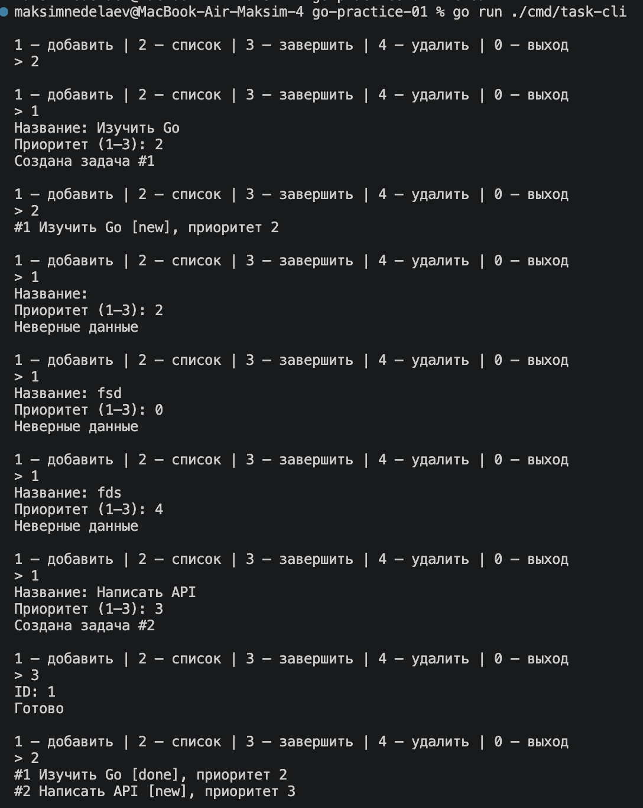
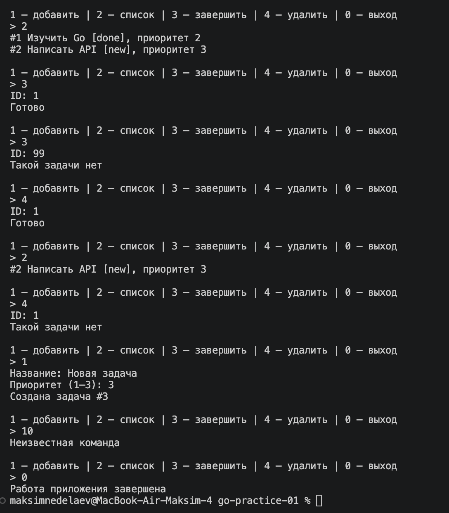
## Проверка для Get
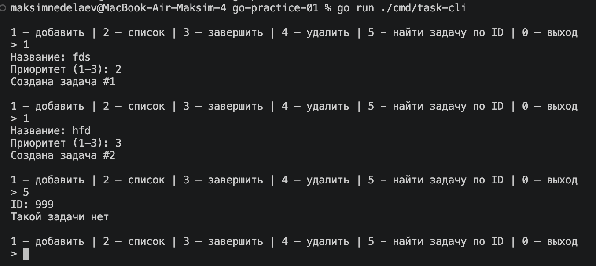
## Проверка для фильтра по статусу
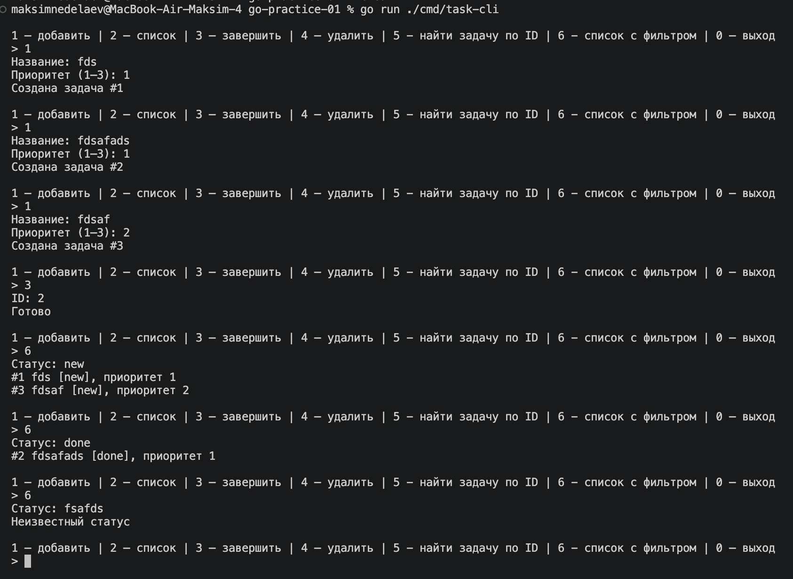
## Проверка неизменяемости возвращаемого List()
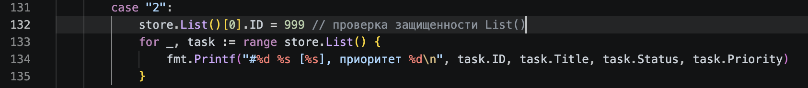
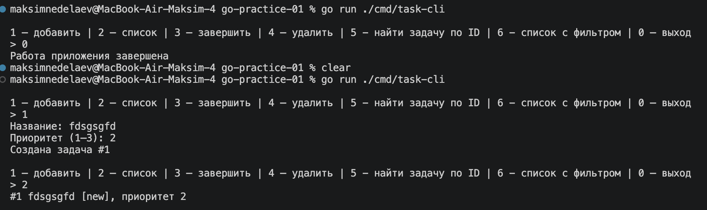

## Что осталось сделать
##### Обязательные задания выполнены

# Практическая работа № 5. Пакеты, Git, JSON и первые тесты
## Выполнено
1. Реализована Load
2. Реализована Save
3. Дополнительные тесты
### 2 одновременно работающих экзампляра консольного приложения могут перезаписать результаты друг друга, так как они работают независимо друг от друга, и 1 экземпляр может вносить изменения в то состояние файла, которое было на момент его запуска, а не на момент изменения экзампляром 2

## Команда запуска
### go run ./cmd/task-cli-json

## Проверенные данные
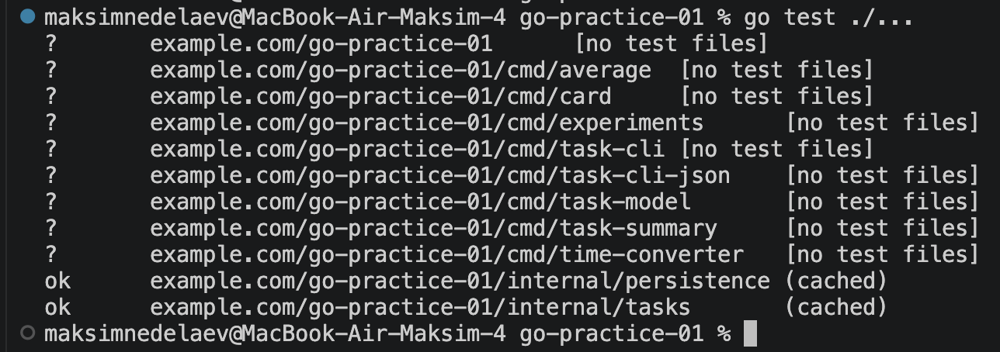
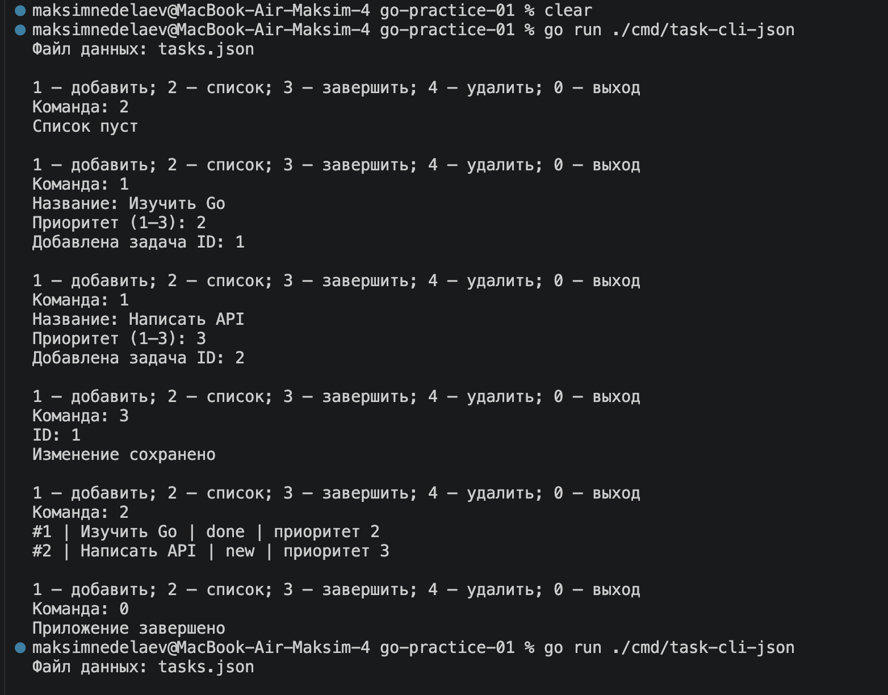
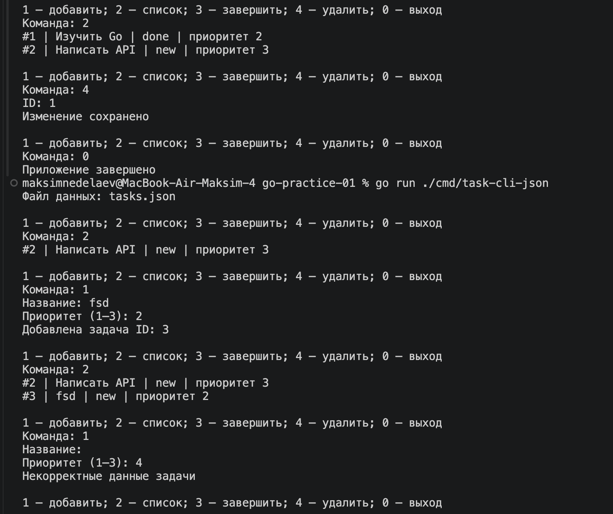
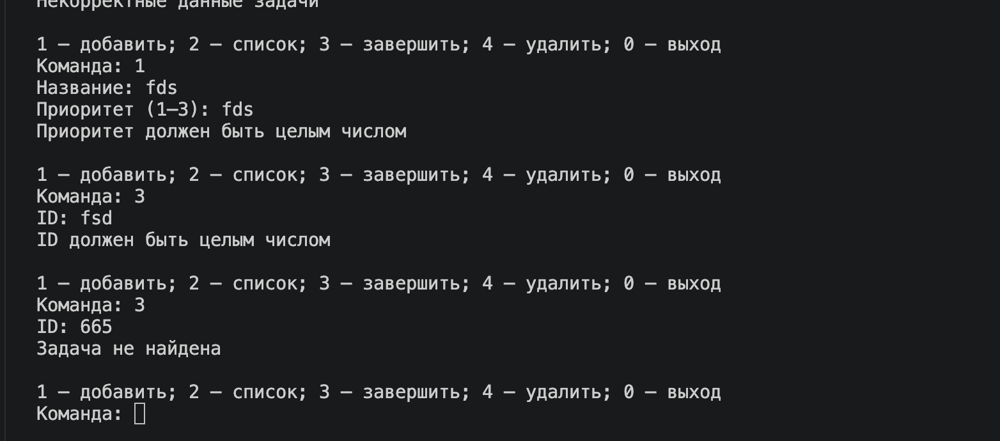
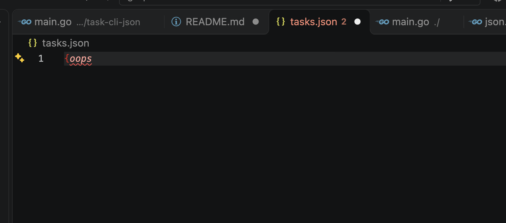
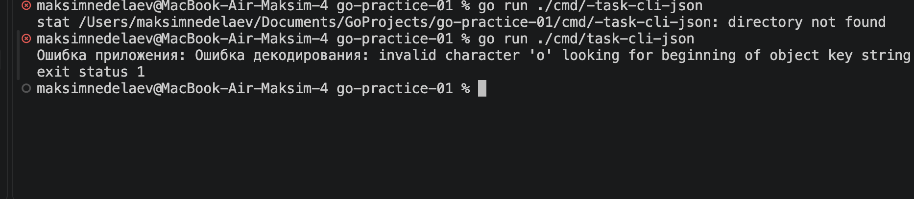

## Что осталось сделать
### Обязательные задания выполнены